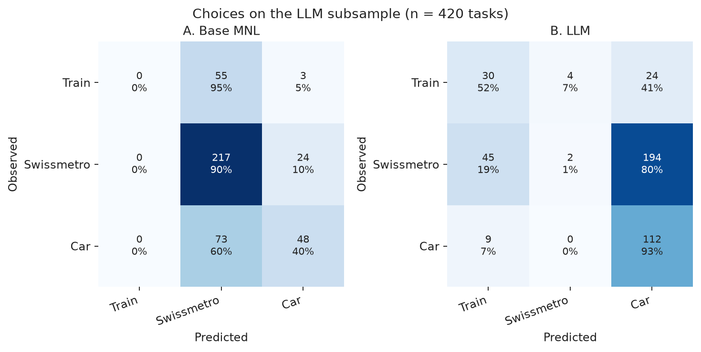

# Can LLMs Simulate Travellers?

Comparing LLM-simulated mode choice with a multinomial logit model on Swissmetro.

**Veeraj Jain** — undergraduate, Civil Engineering, Indian Institute of Technology Delhi.
October 2026.

This repository asks a narrow question. If a small open-weights language model is given a traveller's attributes and the time, cost, and headway of the train, Swissmetro, and car, does it choose the way a multinomial logit fitted to the same stated-preference survey does?

It does not. On 420 held-out choice tasks the logit is accurate on 63.1% and its mean probabilities match the observed shares. The language model is accurate on 34.3%, below the 57.4% of a rule that always picks Swissmetro, and it puts most of its probability on the car. It does notice an annual public-transport pass. It does not trade off time and cost with the right sign. Every number below is written out by `src/run_all.py` into `results/`.

## Motivation

Transport models used in appraisal are estimated on surveys. A recent claim is that a language model can stand in for those respondents: give it a persona and a scenario, and read its choice as a simulated traveller. That claim is easy to overstate and easy to test on a dataset with a published benchmark.

Swissmetro (Bierlaire, Axhausen, and Abay, 2001) is a stated-preference survey of intercity travel in Switzerland, including a hypothetical maglev. The Biogeme example `b01a` is a four-parameter multinomial logit with a known log-likelihood. This study reproduces that model, adds one richer specification, and scores one local instruct model on the same held-out people. The logit is fitted to other respondents from this survey. The language model sees none of their choices. Losing to the logit is the expected direction. The size of the gap, and the way the gap is made, are the result.

## Data

The file `data/swissmetro.dat` is the public release from the Transport and Mobility Laboratory at EPFL (`https://transp-or.epfl.ch/data/swissmetro.dat`). SHA-256 `27432693cf052985d79a950b4b888be3efca798fc89b0d3ffefe40608ede00f2`. The code checks the checksum and downloads the file only if it is missing.

The estimation sample uses the Biogeme filters: `PURPOSE` in {1, 3} (commute or business) and `CHOICE != 0`. That leaves **6,768 tasks from 752 people, nine tasks each**. The excluded count is 3,960. Choices are train 908, Swissmetro 4,090, car 1,770. The car is unavailable for 129 people (5,607 tasks have a car). The chosen alternative is always available.

Time and cost enter the logit divided by 100, as in the Biogeme example. For a holder of the General Abonnement, `TRAIN_CO` in the raw file is the **annual** pass price (median 2,900 CHF), not the fare of the trip (median rail fare without the pass: 84 CHF). The payable train cost and the payable Swissmetro cost are set to zero for pass holders. The car cost is unchanged. The prompt is told about the pass in a sentence, and it is shown the zero fares. It is not shown the annual price.

The filtered sample is uneven: 577 of 752 people are on a business trip, and 589 are men. One hundred people hold the pass. Those facts bound every share in this repository.

## Models

### Multinomial logit

Swissmetro's alternative-specific constant is fixed at 0. The base systematic utilities are

```
V_train = ASC_TRAIN + B_TIME * (train time / 100) + B_COST * (train cost / 100)
V_SM    =                 B_TIME * (SM time / 100)    + B_COST * (SM cost / 100)
V_car   = ASC_CAR   + B_TIME * (car time / 100)   + B_COST * (car cost / 100)
```

with unavailable alternatives dropped from the logit denominator. The code maximises the log-likelihood by Newton–Raphson with the analytical gradient and Hessian. Classical standard errors are the inverse Hessian. The tables below use cluster-robust standard errors, one cluster per respondent, because the nine tasks of one person are not nine people. Observation-level robust standard errors are also stored; they match the Biogeme robust standard errors. p-values use the standard normal approximation. There is no small-sample correction.

The richer specification adds seven parameters, nested in the base model:

- business-trip shifts of the train and car constants (commute is the base)
- a pass-holder shift for the train, and one for Swissmetro
- headway, in the same per-100-minutes units, on the train and Swissmetro (zero for the car)
- an extra time coefficient for age 55 or over (`AGE` in {4, 5})
- an extra cost coefficient for income above 100,000 CHF/year (`INCOME == 3`)

Value of time, in CHF per hour, is `60 * B_TIME / B_COST`. The hundreds cancel because both attributes are scaled by 100. The standard error is the delta method with the cluster covariance.

### Split

`numpy` Generator seed 42 shuffles the 752 respondent IDs. The test set is 20% of people: **150 people, 1,350 tasks**. The training set is **602 people, 5,418 tasks**. Models used for prediction are estimated on the training people only. The published Biogeme comparison uses the full 6,768.

### Language model

The model is **Qwen2.5-1.5B-Instruct**, quantised **Q4_K_M** (1,117,320,736 bytes), run locally with `llama-cpp-python`. No API key. Four CPU threads, context 1,024. The Llama seed is 42. Temperature is not used, because nothing is sampled.

The prompt is `prompts/system.txt` plus `prompts/user_template.txt`. It states the purpose, age band, gender, income band, who pays, luggage, and whether the person holds a General Abonnement, then the door-to-door time, trip cost, and headway of each available mode. The requested reply is a single digit: 1 train, 2 Swissmetro, 3 car. Choice probabilities are the next-token distribution, restricted to those digit tokens and renormalised over modes that exist in the task. A prefix cache keeps the system turn fixed.

The wording was not selected by test-set accuracy. A 24-task pilot on training respondents checked that the top token was a digit (format rate 1.000). Eight further tasks were scored only to time the machine; three of them fell in the test people and are excluded from the evaluation. The cache key changes if the prompt files change.

The reported LLM sample is **420 tasks from 147 test respondents**, at most four tasks each, drawn with seed 49 (`42 + 7`). Observed choices: train 58, Swissmetro 241, car 121. Elasticities use **84 of those tasks (71 people)**, seed 53, at most two per person. Cost elasticities use the **76** tasks in that subset where the person does not hold a pass, because a percentage change of a zero fare does nothing. Shocks are −50, −20, −10, +10, +20, and +50 percent, applied to train and Swissmetro time and cost. A separate ±10 minute and ±10 CHF pair, on tasks where the shift does not hit zero (time at least 20 minutes and cost at least 10 CHF), is the arc value of time.

## Results

### The published logit

On the full filtered sample the base model matches Biogeme example `b01a`.

| Parameter | Estimate | Cluster s.e. | Cluster t | Robust t |
| --- | ---: | ---: | ---: | ---: |
| ASC train | −0.701 | 0.183 | −3.82 | −8.49 |
| ASC car | −0.155 | 0.129 | −1.20 | −2.66 |
| Time, per 100 min | −1.278 | 0.238 | −5.38 | −12.26 |
| Cost, per 100 CHF | −1.084 | 0.161 | −6.72 | −15.89 |

Log-likelihood −5,331.252. Null log-likelihood (equal probability among available modes) −6,964.663. ρ² = 0.235. ρ̄² = 0.234. The null is coefficients at zero, not constants only.

Time and cost have the expected negative signs. The car constant is significant in the robust (task-level) calculation that Biogeme reports, and it is not significant once the nine tasks of each person are clustered. Both numbers are in `results/mnl_summary.json`. The cluster figure is the one used here for inference.

Value of time: **70.7 CHF/hour**, cluster delta-method standard error **13.8**. A 95% interval is about 44 to 98 CHF/hour. This is the trade-off inside this stated-preference design. It is not an appraisal value of time.

At equal time and cost, the train constant is worth −64.7 CHF relative to Swissmetro (cluster s.e. 20.7). The car constant is worth −14.3 CHF (s.e. 12.1), consistent with the insignificant cluster t.

### The richer logit

Eleven parameters. Log-likelihood −4,889.826. ρ² = 0.298. ρ̄² = 0.296. Likelihood-ratio statistic against the base model: 882.85 on 7 degrees of freedom. That p-value treats tasks as independent, so it overstates how much new information the extra parameters add. The cluster t-statistics are the ones to read.

| Parameter | Estimate | Cluster s.e. | Cluster t |
| --- | ---: | ---: | ---: |
| ASC train | −1.584 | 0.246 | −6.45 |
| ASC car | −0.972 | 0.193 | −5.05 |
| Time, per 100 min | −1.523 | 0.217 | −7.02 |
| Cost, per 100 CHF | −1.411 | 0.348 | −4.05 |
| Train ASC, business vs commute | 0.855 | 0.208 | 4.11 |
| Car ASC, business vs commute | 0.814 | 0.183 | 4.44 |
| GA holder, train | 2.169 | 0.494 | 4.39 |
| GA holder, Swissmetro | 0.074 | 0.490 | 0.15 |
| Headway, per 100 min | −0.663 | 0.114 | −5.84 |
| Extra time coefficient, age 55+ | 0.768 | 0.253 | 3.04 |
| Extra cost coefficient, income >100k | 0.460 | 0.342 | 1.35 |

For a person who is under 55 and not in the top income band, the value of time is **64.8 CHF/hour** (s.e. 16.7). For age 55+ it falls to **32.1** (s.e. 15.9); the interaction itself has cluster t = 3.04, so older respondents are less time-sensitive in this file. The high-income point estimate is **96.1 CHF/hour** (s.e. 18.1) with cluster t = 1.35 on the cost interaction. That income result is not established. Headway is disliked about 0.436 times as much as in-vehicle time, which is **28.2 CHF per hour of headway**. The pass-holder shift on the train is worth 153.8 CHF (s.e. 55.5) on top of the free fare. People who like the train are the ones who buy the pass; the coefficient is not a causal effect of handing someone a pass. The Swissmetro pass shift is indistinguishable from zero.


### Held-out people, before the language model

Predicted by models fitted on the 602 training people, scored on all 1,350 test tasks.

| Model | Accuracy | Log-likelihood | Mean per task | Mean probability, train / SM / car |
| --- | ---: | ---: | ---: | --- |
| Majority class (always Swissmetro) | 57.3% | — | — | hard share 0 / 100 / 0 |
| Constants only | 57.3% | −1,221.204 | −0.905 | 13.0 / 60.0 / 27.0 |
| Base MNL | 64.3% | −1,138.100 | −0.843 | 13.4 / 57.9 / 28.7 |
| Richer MNL | 67.4% | −1,060.671 | −0.786 | 13.0 / 57.4 / 29.7 |

Observed shares on these tasks: **13.9% / 57.3% / 28.8%**. The base model's mean probabilities sit on those shares. Its hard prediction (the mode with the highest probability) selects the train on **zero** of the 1,350 tasks. Train is often second. Of 188 train choosers, 178 are predicted as Swissmetro and 10 as car. Accuracy therefore misses a model whose probabilities are in the right place. The constants-only model also always predicts Swissmetro, because both constants are negative and Swissmetro is always available, so it ties the majority rule. The 7.0 point accuracy gain of the base model over that rule is the contribution of time and cost.

The richer model does sometimes predict the train (hard share 5.3%, train recall 28.7% on this full test set). Quote the log-likelihood and the probability shares together with the accuracy.

### Language model against the same tasks

The comparison that includes the LLM uses the 420-task subset, not all 1,350. The logit rows below are re-scored on those 420 so the models share a denominator. Respondent bootstrap: 1,000 resamples of the 147 people.

| Model | Accuracy | 95% bootstrap interval | Log-likelihood | Mean per task |
| --- | ---: | --- | ---: | ---: |
| Majority / constants (hard) | 57.4% | 51.4 to 64.1 | −381.03 (constants) | −0.907 |
| Base MNL | 63.1% | 56.8 to 69.6 | −357.22 | −0.851 |
| Richer MNL | 67.1% | 61.3 to 73.4 | −324.01 | −0.771 |
| Qwen2.5-1.5B-Instruct, Q4 | 34.3% | 28.1 to 40.7 | −693.20 | −1.650 |

Accuracy differences, same bootstrap:

| Contrast | Percentage points | 95% interval |
| --- | ---: | --- |
| Base MNL − LLM | +28.8 | +18.8 to +39.5 |
| Base MNL − majority | +5.7 | +0.7 to +11.0 |
| LLM − majority | −23.1 | −35.5 to −11.0 |
| Richer MNL − base MNL | +4.0 | −0.2 to +7.9 |

On these 420 tasks the richer model has a clearly better log-likelihood. Its accuracy gain over the base model has an interval that includes zero. The LLM is worse than the majority rule by a margin the bootstrap does not cover.

Mean probabilities and hard shares on the same 420 tasks. Observed shares: **13.8% train, 57.4% Swissmetro, 28.8% car**.

| Model | Mean probability | Hard prediction |
| --- | --- | --- |
| Base MNL | 13.4 / 58.0 / 28.7 | 0.0 / 82.1 / 17.9 |
| Richer MNL | 12.9 / 57.3 / 29.8 | 5.5 / 73.1 / 21.4 |
| LLM | 29.6 / 12.7 / 57.7 | 20.0 / 1.4 / 78.6 |

The LLM's mean probability on the chosen mode is 0.344 (base MNL 0.495). Brier score 0.907 against 0.519. Correlation of task-level probabilities with the base MNL: train 0.38, Swissmetro −0.04, car 0.36. The two hard predictions agree on 16.0% of tasks.

The LLM's top token is a digit on every one of the 420 tasks (mean digit-token mass 0.999). On 96.0% of tasks that digit is a mode which is available. Predictions used below renormalise over available modes, so an unavailable car is not chosen. Swissmetro recall is 2 of 241 choices (0.8%). Car recall is 92.6%. Train recall is 51.7%, which is the one mode the LLM recovers more often than the base logit, whose train recall on this subset is zero.




### Elasticities and value of time

Own elasticities use the mean predicted probability of the mode whose attribute changed: `((share_new − share_base) / share_base) / (percent / 100)`. Intervals are a respondent bootstrap. All **24** base-MNL elasticities in `results/elasticities.csv` are negative, and each interval excludes zero.

The LLM does not follow. Every train-time elasticity is positive: a slower train receives more train probability. The intervals at −50%, +20%, and +50% lie entirely above zero.

| Shock | Sample | MNL probability | MNL elasticity | LLM probability | LLM elasticity |
| --- | --- | --- | ---: | --- | ---: |
| Train time, −50% | 84 | 12.5% → 29.1% | −2.68 | 28.0% → 25.8% | +0.16 (0.03 to 0.28) |
| Train time, +50% | 84 | 12.5% → 5.4% | −1.14 | 28.0% → 30.1% | +0.16 (0.04 to 0.31) |
| Swissmetro time, +50% | 84 | 60.0% → 48.4% | −0.38 | 13.5% → 12.6% | −0.13 (−0.27 to +0.01) |
| Swissmetro cost, +50% | 76 paying | 58.2% → 45.8% | −0.42 | 14.0% → 12.9% | −0.16 (−0.27 to −0.04) |

The last row is the one LLM cost response whose interval excludes zero and has the expected sign. The share moves by about one percentage point. A +20% train-fare shock has the wrong sign and an interval above zero (elasticity +0.34, interval 0.01 to 0.70). The other LLM cost intervals include zero. Flat or wrong-signed cost response is the pattern; one correctly signed Swissmetro cell does not overturn it.

A central difference of ±10 minutes and ±10 CHF, on 76 tasks where neither shift is clipped at zero, recovers **72.6 CHF/hour** from the base MNL for the train and again **72.6** for Swissmetro. That matches `60 * B_TIME / B_COST` on the training respondents (72.6, cluster s.e. 16.2). The bootstrap interval of this arc ratio is only a few thousandths of a franc wide, because the ratio is pinned by two coefficients and barely depends on which respondents are resampled. The cluster standard error on the coefficient ratio is the uncertainty that belongs in a sentence. The same ±10 shifts move the LLM share in the **wrong direction** for both time and cost (`interpretable: false` in `results/implied_vot.csv`). The resulting ratios are not values of time.


### Where the two predictors diverge

**Annual pass.** On the 41 pass-holder tasks in the 420 (16 people), the observed shares are 73.2% train, 24.4% Swissmetro, 2.4% car. The LLM's mean probabilities are 78.3 / 6.7 / 15.0. The base MNL's are 16.6 / 73.8 / 9.6. Without the pass (379 tasks, 131 people) the observed train share is 7.4% and the LLM's train probability is 24.3%; the base MNL stays near 13.0%. The pass gap in the train share is 65.8 percentage points in the data (73.2 − 7.4), 54.0 in the LLM (78.3 − 24.3), and 3.6 in the base logit (16.6 − 13.0), which has no pass coefficient beyond the zero fare.

Saying the words "General Abonnement" matters. On those same 41 tasks, with the fares still at zero but the pass not mentioned, the LLM's train probability falls from 78.3% to 60.1%, Swissmetro rises from 6.7% to 13.9%, and the car rises from 15.0% to 26.0%. Mean absolute change in the three probabilities: 0.122. The zeros and the sentence both move the distribution. Sixteen people is a small base for anything sharper than that.

**Equal attributes.** On the 84 elasticity tasks, time is set to 90 minutes, cost to 50 CHF, and headway to 30 for every available mode. The car stays unavailable where it was unavailable. Mean probabilities: base MNL 22.6% train, 44.7% Swissmetro, 32.7% car; LLM 25.9 / 27.4 / 46.7. The LLM's hard prediction on this probe is 69.0% car. Swissmetro is the fast mode in the raw file (mean door-to-door time 84.5 minutes, against 166.1 for the train and 148.7 for the car when the car exists). The LLM under-chooses it even after that advantage is removed. The failure mode is a car prior and a missing Swissmetro share, together with a time response of the wrong sign. It is not a failure to notice the annual pass.

A +10 CHF fare imposed on pass holders in the elasticity subsample covers 8 tasks. That check is stored in `results/summary.json` under `ga_plus_10chf` and is too small to interpret.


The full scoring run took 43.9 minutes on four CPU threads, about 0.82 seconds per prompt after the prefix cache was warm.

## Reproduce

```bash
bash run.sh
```

The script creates `.venv`, installs `requirements.txt`, downloads the Swissmetro file if the checksum fails, downloads the GGUF into `models/` (gitignored, about 1.1 GB), and runs `python -m src.run_all`. A completed cache under `results/cache/` is reused, so a second run recomputes the logit and reloads predictions instead of rescoring. Flags:

```bash
bash run.sh --skip-llm          # logit, split, and coefficient figure only
bash run.sh --pilot-only        # format check on 24 training respondents
bash run.sh --llm-n 420 --elast-n 84
```

Tests, which do not load the language-model weights:

```bash
.venv/bin/python -m unittest tests.test_mnl tests.test_prompts
```

Stack: Python 3.12, NumPy, pandas, SciPy, Matplotlib, llama-cpp-python. No GPU.

## Repository

| Path | Contents |
| --- | --- |
| `src/data_utils.py` | Filters, General Abonnement costs, respondent split, shocks |
| `src/mnl.py` | Logit likelihood, Newton fit, cluster standard errors, value of time |
| `src/llm_choice.py` | Local model, digit-token probabilities |
| `src/prompts.py` | Persona and scenario text |
| `src/evaluate.py` | Accuracy, bootstrap, elasticities |
| `src/run_all.py` | One pipeline, writes `results/` and `figures/` |
| `prompts/` | The wording that was scored |
| `results/summary.json` | Machine-readable source for the tables above |
| `results/mnl_coefficients.csv` | Every coefficient and standard error |
| `results/elasticities.csv` | Every shock |
| `results/llm_predictions.csv` | One row per scored prompt |
| `docs/explainer.md` | The same material in interview language |
| `report.md` | Short write-up of the same run |

If a number in this file disagrees with `results/summary.json`, the JSON wins. Rounding in the tables is three decimals for coefficients, one decimal for percentages and for CHF/hour, and the log-likelihoods are printed at the precision shown.

## Limitations

- The language model has 1.5 billion parameters and the weights are 4-bit. A larger model, or the same model fine-tuned on the training respondents, could behave differently. This run does not speak for "LLMs" as a class.
- The data are stated preference about a mode that does not exist. Sensitivity to time on the form can exceed sensitivity on a real Tuesday.
- The filtered sample is mostly business trips and mostly men.
- The LLM is scored on 420 of 1,350 test tasks. Elasticities use 84, and the pass-wording check uses 41 tasks from 16 people.
- The logit sees 602 respondents from this survey. The LLM sees a zero-shot prompt. The comparison is informative about simulation without fitting. It is an easy win for the logit.
- Tasks within a person are dependent. Cluster standard errors and the respondent bootstrap are there for that reason. McNemar p-values in the JSON treat tasks as independent and are anti-conservative; they are not the intervals quoted above.
- The pass coefficient is not causal. The base model never hard-predicts the train, so accuracy understates it.
- One prompt wording. Origin, destination, first class, ticket type, and group size are not in the prompt.
- Percentage cost shocks do not move a zero fare. The arc value of time drops tasks that would clip at zero.
- The logit assumes independence of irrelevant alternatives. A nested logit for train and Swissmetro is the obvious relaxation, and it was left out so the baseline would stay the published model.
- The survey is public and widely taught. The equal-attribute probe is the check on a label prior. It shows a car prior.

## What I would do next

I would keep this prompt and this 420-task file frozen, and change one thing at a time.

1. A mixed logit with a person-level random coefficient on time, which is what the cluster standard errors are asking for, and a nested logit with train and Swissmetro in one nest.
2. The same prompt on a larger local instruct model, scored once on these 420 tasks, with the wording pre-registered.
3. A small set of prompt variants scored only on training respondents. The test people get touched once, after the wording is locked.
4. A model fine-tuned on the training respondents' choices, evaluated on the held-out people, reported next to this zero-shot baseline so the gain from fitting is visible.
5. A reliability diagram for both predictors. Accuracy will keep hiding the base logit's train probabilities.
6. A revealed-preference dataset, where Swissmetro is not one of the labels and the annual-pass coding can be checked against actual tickets.

I would not put 70.7 CHF/hour into a cost-benefit spreadsheet, and I would not replace a mode-choice model with this language model.

## Licence and citation

Code and write-up: MIT, copyright Veeraj Jain, 2026. See `LICENSE`.

The Swissmetro file is not covered by that licence. Cite:

Bierlaire, M., Axhausen, K., and Abay, G. (2001). The acceptance of modal innovation: The case of Swissmetro. *1st Swiss Transport Research Conference*.

Variable codes follow the EPFL description, `https://transp-or.epfl.ch/documents/technicalReports/CS_SwissmetroDescription.pdf`. The logit benchmark is the Biogeme Swissmetro example `b01a`.
