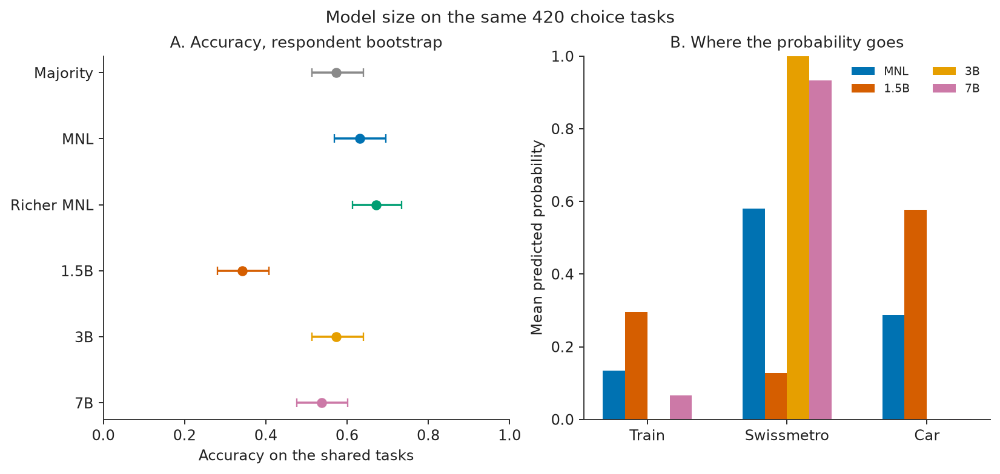

# Can LLMs Simulate Travellers?

**Comparing three local instruct models with a multinomial logit on Swissmetro**

Veeraj Jain  
Undergraduate, Civil Engineering, Indian Institute of Technology Delhi  
October 2026

## Question

Mode-choice models used in appraisal are fitted to surveys. A recent suggestion is that a language model can take the respondent's place: describe the person and the alternatives, and treat the model's reply as a simulated choice. I tested that suggestion on one public stated-preference dataset and three sizes of one open-weights model, against the multinomial logit that the same dataset is usually taught with.

The dataset is Swissmetro (Bierlaire, Axhausen, and Abay, 2001). Respondents chose among the existing train, a proposed maglev, and a car. I kept the standard analysis sample: trip purpose commute or business, and a stated choice. That is 6,768 tasks from 752 people, nine tasks each. For holders of the General Abonnement, the raw train "cost" is the annual pass price. I set the train and Swissmetro trip costs to zero for those people, which is what the Biogeme example does, and I told the language model the same thing in words.

## The logit

The baseline is the Biogeme specification `b01a`. Swissmetro's alternative-specific constant is fixed at zero. One time coefficient and one cost coefficient are shared. Time and cost are divided by 100. I maximise the logit log-likelihood by Newton steps and report cluster-robust standard errors, with one cluster per person, because nine answers from one person are not nine people.

On the full sample the estimates match the published example: log-likelihood -5,331.252 against a null of -6,964.663, $\rho^2$ = 0.235, $\bar{\rho}^2$ = 0.234. The coefficients are ASC train -0.701 (cluster t = -3.82), ASC car -0.155 (cluster t = -1.20), time -1.278 (cluster t = -5.38), and cost -1.084 (cluster t = -6.72). The car constant is the parameter that looks significant when each task is treated as independent (robust t = -2.66) and does not survive clustering. The value of time is 60 times the time coefficient over the cost coefficient: 70.7 CHF per hour, with a cluster standard error of 13.8. That number belongs to this stated-preference design. I would not carry it into an appraisal.

A richer model adds business-trip shifts of the train and car constants, pass-holder shifts, headway, an extra time coefficient for age 55 and over, and an extra cost coefficient for income above 100,000 CHF per year. The log-likelihood rises to -4,889.826 ($\bar{\rho}^2$ = 0.296). The likelihood-ratio statistic against the base model is 882.85 on 7 degrees of freedom, but that test counts tasks as independent. Under clustering, the pass shift on Swissmetro (t = 0.15) and the high-income cost shift (t = 1.35) are weak. The pass shift on the train (t = 4.39), headway (t = -5.84), and the senior time shift (t = 3.04) are not. For a non-senior person outside the top income band the richer value of time is 64.8 CHF/hour. For age 55+ it is 32.1. The high-income point estimate is 96.1 CHF/hour and I do not treat it as established. The train pass shift is worth 153.8 CHF on top of a zero fare (s.e. 55.5). People who already prefer the train are those who buy the pass, so this is not a causal effect of the pass.

I held out 150 people (1,350 tasks) by respondent ID, seed 42, and estimated on the other 602. On the held-out people the base model is accurate on 64.3% of tasks, the richer model on 67.4%, and a constants-only model on 57.3%, which is also what a majority-class rule achieves by always picking Swissmetro. Mean predicted probabilities from the base model are 13.4% train, 57.9% Swissmetro, and 28.7% car, against observed shares of 13.9%, 57.3%, and 28.8%. The hard prediction of the base model never selects the train. Accuracy is the wrong single summary of that model. The test log-likelihood is -1,138.100 for the base model and -1,060.671 for the richer one.

## The language models

The models are Qwen2.5-Instruct at 1.5B, 3B, and 7B parameters, each stored as a 4-bit GGUF (`Q4_K_M`) and run locally with llama.cpp. The 7B file is two shards; llama.cpp loads both when it is given the first. No API, and no sampling. The probability of each mode is the next-token probability of the digit 1, 2, or 3, renormalised over the modes that are available. The prompt is frozen. It gives purpose, age, gender, income, who pays, luggage, the annual pass, and the time, cost, and headway of each option. I checked the format on 24 training respondents. Every top token was a digit for all three models, and I did not edit the wording to chase accuracy. The scored sample is the same 420 tasks from 147 held-out people. On this machine a prompt takes about 0.82 seconds at 1.5B, 1.70 seconds at 3B, and 3.72 seconds at 7B.

Time and cost shocks for the 1.5B and 3B models use 84 of those tasks. The same grid on 84 tasks would have added about three hours for the 7B model after the 420 base tasks, so its shocks use 36 of those 84, drawn with seed 61 and at most one task per person. Accuracy, market shares, the pass split, and the equalised-attribute probe use the same tasks for all three models. The run is deterministic given the weights and the prompt files.

## Comparison

On the 420 tasks the majority rule scores 57.4%. The base logit scores 63.1% (bootstrap interval 56.8 to 69.6, resampling the 147 people). The richer logit scores 67.1%. The 1.5B model scores 34.3% (interval 28.1 to 40.7). The gap between the base logit and the 1.5B model is 28.8 percentage points, with an interval from 18.8 to 39.5. It is 23.1 points below the majority rule, and that interval stays below zero.

Log-likelihood on the same tasks: -357.22 for the base logit, -324.01 for the richer logit, -381.03 for constants only, and -693.20 for the 1.5B model. Its mean probability on the chosen alternative is 0.344.

The shares explain that accuracy. Observed shares are 13.8% train, 57.4% Swissmetro, 28.8% car. Base-logit probabilities are 13.4 / 58.0 / 28.7. The 1.5B probabilities are 29.6 / 12.7 / 57.7, and its hard prediction is 20.0 / 1.4 / 78.6. It selects Swissmetro on 6 of 420 tasks and is right on 2 of the 241 Swissmetro choices. It is comparatively good at the train (recall 51.7%), which is the mode the base logit's hard rule never picks. The two hard predictions agree on 16.0% of tasks. Task-level probabilities correlate 0.38 for the train, -0.04 for Swissmetro, and 0.36 for the car.

The annual pass is the place where the 1.5B model tracks the sample and the base logit does not. On 41 pass-holder tasks the observed train share is 73.2% and the model's mean train probability is 78.3%. On the other 379 tasks those figures are 7.4% and 24.3%. The base logit, which only sees a zero fare, stays near 16.6% and 13.0%. Removing the sentence that names the pass, and leaving the fares at zero, moves the train probability on those 41 tasks from 78.3% to 60.1%. Both the zeros and the wording matter. Sixteen people is a thin sample for a finer claim.

The time and cost shocks go the other way. All 24 base-logit own elasticities for train and Swissmetro time and cost are negative, and each bootstrap interval excludes zero. Making the train 50% slower moves the logit train probability from 12.5% to 5.4%. It moves the 1.5B probability from 28.0% to 30.1% (elasticity +0.16, interval 0.04 to 0.31). Making the train 50% faster also lowers the 1.5B train probability. A +/-10 minute and +/-10 CHF central difference recovers 72.6 CHF/hour from the logit, matching the training-sample coefficient ratio (cluster s.e. 16.2). The same shifts move the 1.5B share in the wrong direction, so I do not report a 1.5B value of time. One Swissmetro fare increase of 50%, on 76 fare-paying tasks, has a correctly signed 1.5B elasticity whose interval excludes zero (-0.16, interval -0.27 to -0.04). The probability only moves from 14.0% to 12.9%. That single cell does not describe the cost responses as a whole.

When time, cost, and headway are equalised on the 84-task sample, the logit still puts 44.7% on Swissmetro and the 1.5B model puts 46.7% on the car. Swissmetro is the fast alternative in the raw file (mean 84.5 minutes, against 166.1 by train). The 1.5B model under-chooses it after that advantage is removed. At this size the bias is a car prior, not a blindness to the annual pass.

## Model size

The same 420 tasks, the same prompt, and the same digit-token probabilities, at three sizes:

| Model | Accuracy (interval) | Log-likelihood | Mean probability, train / SM / car | Hard prediction |
| --- | --- | ---: | --- | --- |
| Majority rule | 57.4% (51.4 to 64.1) | -381.03, constants | always Swissmetro | 0 / 100 / 0 |
| Base logit | 63.1% (56.8 to 69.6) | -357.22 | 13.4 / 58.0 / 28.7 | 0.0 / 82.1 / 17.9 |
| 1.5B | 34.3% (28.1 to 40.7) | -693.20 | 29.6 / 12.7 / 57.7 | 20.0 / 1.4 / 78.6 |
| 3B | 57.4% (51.4 to 64.1) | -1,973.34 | 0.05 / 99.95 / 0.00 | 0 / 100 / 0 |
| 7B | 53.8% (47.6 to 60.1) | -2,819.35 | 6.7 / 93.3 / 0.04 | 6.4 / 93.6 / 0 |

The gap from the base logit is 28.8 points at 1.5B (18.8 to 39.5), 5.7 points at 3B (0.7 to 11.0), and 9.3 points at 7B (3.2 to 15.3). Every interval stays above zero. The 3B model hard-predicts Swissmetro on all 420 tasks, so its accuracy equals the majority rule exactly and its bootstrap difference from that rule is zero. The 7B model is 3.6 points below the majority rule (interval 0.7 to 6.8 points below). It is right on 221 of 241 Swissmetro choices, 5 of 58 train choices, and 0 of 121 car choices. It never selects the car.

Accuracy is the flattering summary. Log-likelihood moves the other way: -693, then -1,973, then -2,819. The larger models put almost no probability on the train and the car, so a traveller who chose either of those modes contributes a large negative log probability. Mean probability on the chosen alternative is 0.344 at 1.5B, 0.574 at 3B, and 0.536 at 7B. The 3B figure matches the majority rule because the probability on Swissmetro is 99.95%, not because the model has learned the trade-off.

The car prior shrinks, and a Swissmetro prior replaces it. On the 84 tasks with time, cost, and headway equalised, mean probabilities are:

| Model | Train | Swissmetro | Car |
| --- | ---: | ---: | ---: |
| Base logit | 22.6 | 44.7 | 32.7 |
| 1.5B | 25.9 | 27.4 | 46.7 |
| 3B | 11.5 | 88.3 | 0.2 |
| 7B | 28.5 | 71.5 | 0.0 |

The 7B hard prediction on that probe is 25% train and 75% Swissmetro. The car share is gone. The Swissmetro share is still far above the logit. Equal attributes do not produce equal probabilities at any of the three sizes.

The annual-pass tilt does not survive the step up in size. On the 41 pass-holder tasks the train probability is 78.3% at 1.5B, 0.002% at 3B, and 0.04% at 7B, against an observed train share of 73.2%. On the other 379 tasks it is 24.3%, 0.06%, and 7.4%. Removing the sentence that names the pass, with the fares still at zero, barely moves the 3B model (mean absolute probability change 0.00009). It moves the 7B model a great deal, and in the wrong direction: train probability on those 41 tasks rises from 0.04% to 70.2% when the sentence is deleted. The words "General Abonnement" are what push the 7B model off the train. Sixteen people remains a thin sample, and the direction of the wording effect is the result, not a precise percentage.

I do not report a language-model value of time at any size. The rule in the code requires both the time derivative and the cost derivative to be negative, and the +/-10 CHF shift to move the share by at least half a percentage point. None of the six language-model rows in `results/implied_vot.csv`, and none of the six rows on the common 31-task subset in `results/implied_vot_common.csv`, passes that rule. The logit arc on both samples is 72.6 CHF/hour.

What does move, at 7B, is a large change in level rather than a stable elasticity. On the 36-task shock subset, making the train 50% faster raises the train probability from 0.16% to 24.5%. Making Swissmetro 50% slower lowers its probability from 99.8% to 80.0% (elasticity -0.40, interval -0.63 to -0.19). Making Swissmetro 50% more expensive lowers it from 99.8% to 97.5%, and that interval includes zero. The +/-10 minute shift on the train has the wrong sign, so the arc ratio is not a value of time. At 3B the same 50% shocks move Swissmetro by less than one percentage point, because the probability is already saturated, and the +/-10 shifts move it by less than a hundredth of a point. A huge elasticity on a near-zero train share is an artefact of the denominator. I quote the change in probability instead.

## What this does not show

It does not show that language models cannot represent travellers. It shows that these three 4-bit Qwen2.5 instruct models, with this one prompt, on 420 stated-preference tasks, do not reproduce the logit. Going from 1.5B to 7B removes the car prior and lifts accuracy from 34.3% to the neighbourhood of the majority rule. It does not recover the log-likelihood, the annual-pass tilt, or a value of time. The logit was fitted to 602 other people from the same survey. The language models were not. A fine-tune on the training respondents is a different experiment, and I have not run it.

The data are stated choices about a mode that was never built, from a sample dominated by business travellers and by men. The elasticity subsample is 84 tasks for the 1.5B and 3B models and 36 tasks for the 7B shocks. The pass-wording check is 16 people. Panel dependence is handled with cluster standard errors and a respondent bootstrap; tests that treat tasks as independent, including the likelihood-ratio p-value and the McNemar tests stored in the output, overstate precision. The base logit's hard predictions hide a well calibrated train probability. I would quote the log-likelihood and the probability shares in any interview about this repository. The accuracy line is 34.3%, 57.4%, and 53.8% against 63.1% and against 57.4%, with the bootstrap intervals, and with the shift from a car prior to a Swissmetro prior as the reason the accuracy moved.

The files `results/summary.json`, `report.md`, and `docs/explainer.md` are three views of one run. If they ever disagree, the JSON is the one the code wrote.
